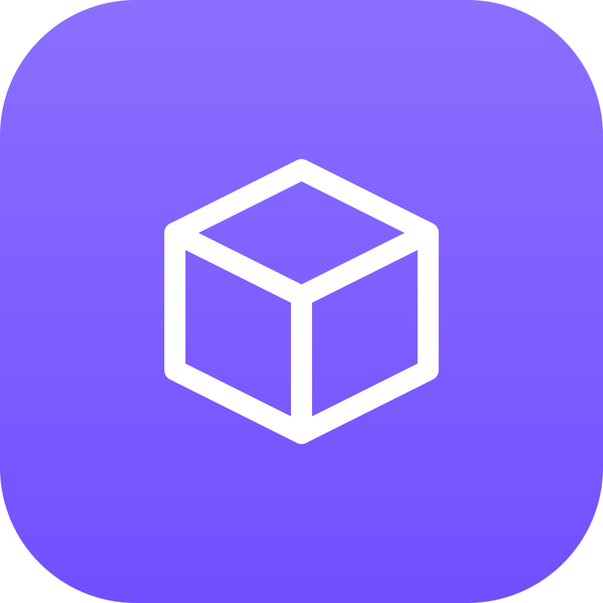
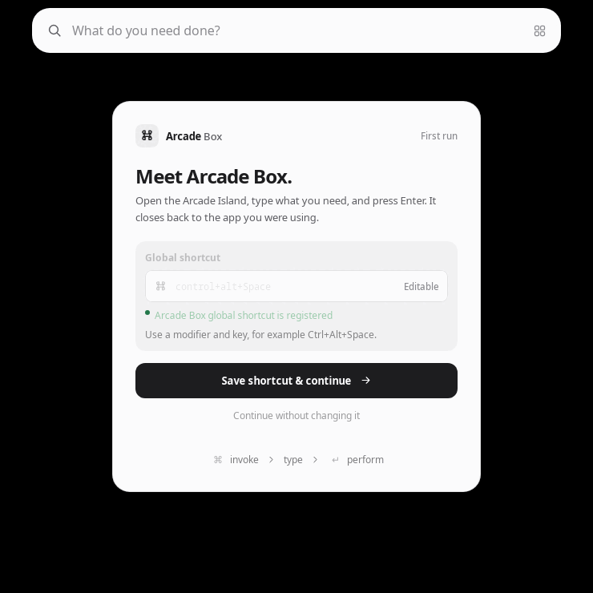

<p align="center">
  
</p>

<h1 align="center">Arcade Box</h1>

<p align="center">File, media, text, web and system tasks in one searchable desktop tool.</p>

<p align="center">
  <a href="https://github.com/qa-p1/Arcade-box/releases/latest"></a>
  <a href="https://github.com/qa-p1/Arcade-box/actions/workflows/ci.yml"></a>
</p>

---

Arcade Box brings file, media, text, web, and system tasks into one searchable desktop tool. Open it with a shortcut, find an action, and use the result in your workflow. It is for people who would otherwise reach for a dozen single-purpose converters and utilities.

It runs on **Linux** (x86_64; X11 and Wayland), **Windows** (x64) and **macOS** (universal: Apple Silicon and Intel). Linux flows run under isolated Xvfb and selected Hyprland flows are verified; Windows and macOS are built and tested in CI, but interactive desktop behavior is unverified.

<p align="center"></p>

## Download and install

Download the file for your system from [Releases](https://github.com/qa-p1/Arcade-box/releases). Or install it from **[Arcade Tools](https://github.com/qa-p1/Arcade-tools) → Apps**, which can also update and remove it.

| Platform | File | How to install |
|---|---|---|
| Linux x86_64 | `Arcade-Box_<version>_amd64.AppImage` | Run it. The first run asks **Install Arcade Box?** and installs to `~/Applications/Arcade/`, adds a menu entry, an `arcade-desktop` command in `~/.local/bin` and an optional start at login. **Just run it once** skips installing. |
| Windows x64 | `Arcade-Box_<version>_x64-setup.exe` | Run Setup (NSIS, per-user, no admin). Adds a Start menu entry, an optional desktop shortcut and start at login, and an `arcade-desktop` command on the user PATH. |
| macOS (universal) | `Arcade-Box_<version>_universal.dmg` | Open the dmg and drag Arcade Box to Applications. Run from the dmg or Downloads, it offers to move itself to Applications. |

- Scripted install: `arcade-desktop --install --silent` (add `--no-launch`, or `--channel C`). `--repair` rewrites the launcher, command and login entries; `--integration-status` prints the integration as JSON. A silent install removes the AppImage it was started from only when that file is in your Downloads folder; add `--keep-download` to keep it there too. Files elsewhere are never removed.
- Every installer also contains the `arcade-box` terminal tool runtime (alias `arcadebox`) and the trusted plugin worker beside the desktop app.
- If `~/.local/bin` is not on PATH, Box shows the exact line to add for your shell.
- Builds are unsigned. On Windows, SmartScreen may warn: choose **More info → Run anyway**. On macOS the app is not notarized: right-click it and choose **Open** the first time.
- If FUSE is missing on Linux, run the AppImage with `--appimage-extract-and-run`.

Successful CI builds on `main` feed the stable version and rolling nightly release workflows. Every release includes `arcade-release.json` and `SHA256SUMS.txt` for Arcade Tools and manual verification. See [Getting started](docs/user/getting-started.md) and [packaging](docs/packaging.md).

## Features

Box has 109 catalog tools. Availability depends on your input, platform, permissions and optional programs.

- **PDFs:** merge, split, reorder, rotate, compress, sign, fill forms, watermark, protect or unlock; images to PDF and back; searchable PDF OCR.
- **Images:** convert, resize, crop, compress, combine, remove backgrounds, passport photos, favicons, upscale, redact, strip metadata, OCR, palettes, compare.
- **Video and audio:** convert, compress to a target size, trim, crop, join, extract audio or frames, GIF/WebP, subtitles, normalize loudness, reduce noise, speed and pitch, metadata, transcription and text-to-speech.
- **Web:** download media, transcripts and thumbnails, save a page as PDF or screenshot, extract page text, WHOIS and public IP.
- **Text and data:** diff, case, clean, JSON/YAML/TOML/XML conversion, CSV/TSV, Markdown/HTML, calculators and unit, currency, time-zone and color conversion.
- **Developer utilities:** regex, number bases, encodings, hashes, UUIDs/ULIDs, JWTs, cron expressions, QR codes and barcodes.
- **Files and desktop:** batch rename, duplicates, folder sizes, encryption, screenshots, screen recording, color picker, ruler, opt-in clipboard history, plain-text paste, window pinning and processes.
- **Pipelines:** save compatible actions as a pipeline and run it again from search, with progress and jobs that keep going while the Island is closed.
- **Plugins:** community plugins run in a restricted WebAssembly worker. Built-in tools stay available without them.

Many tools use optional engines: FFmpeg/ffprobe for media, libvips/ImageMagick for images, qpdf/Poppler/Ghostscript for PDFs, and yt-dlp for media acquisition. Webpage capture reuses an installed Chromium-family or Firefox-family browser. Images-to-PDF and document conversion are built in. Searchable PDF OCR uses Poppler, Tesseract, and qpdf. No Chromium, LibreOffice, img2pdf, OCRmyPDF, or Piper is bundled or silently installed by Box.

Transcription and auto-subtitles use Groq and need `GROQ_API_KEY`. Offline text-to-speech uses SAPI, say, or an installed eSpeak NG/eSpeak. OCR detects Tesseract or an available Lens provider; Engines offers an explicit Tesseract download when needed. See [Features](docs/user/features.md), [Providers](docs/providers.md) and the [tool pages](docs/tools) for formats, privacy, and limits.

## Works with other Arcade apps

Box works on its own and keeps its local tools and fallbacks when used alone. It connects to other installed Arcade apps automatically over Arcade Link, **without needing Arcade Tools**. Turn this on or off with **Connect with other Arcade apps** in Box's Connected apps settings, with a switch per app.

| App | What Box can do with it |
|---|---|
| Arcade Lens | Ask Lens to select part of the screen, recognize it, or inspect a captured image. Box keeps its own screen recorder. |
| Arcade Look | Preview supported files and results in Look. |
| Arcade Clipboard | Send supported text and files to your paired devices. |
| Arcade Shelf | Add result files, folders or text to Shelf as references. |
| Arcade Wheel | Add Box tools, presets or saved pipelines to Wheel. |
| Arcade Find | Find can call Box tools and saved pipelines from its action list. |
| Arcade Tools | Install, update or remove Box from its **Apps** tab. |

Box also provides tool and pipeline actions to other apps. Saved pipelines can combine peer actions with Box tools, and their first stage may open a peer picker. Outbound, network or command effects require first-run approval.

When Arcade Tools is running, its tray icon hosts Box's menu, including **Open pipelines**. When Tools quits, crashes or turns hosting off, Box's own icon returns at once. With **Connect with other Arcade apps** off, Box always shows its own icon.

See [how Box works with other Arcade apps](docs/user/with-other-apps.md) and [Arcade Link actions and pipelines](docs/arcade-link.md).

## Usage

Press **Ctrl+Alt+Space** (**Cmd+Shift+Space** on macOS) to show or hide the Island. Type a task such as **compress PDF**, **resize image** or **JSON**, choose the action and give it an input. The first time you run a tool, Box explains any permission, external program or network access it needs.

| Key | Action |
|---|---|
| Ctrl+K or / | Focus search |
| ↑ / ↓, Enter | Choose and run a result |
| Ctrl+Enter | Run the selected tool |
| Ctrl+O | Choose an input file |
| Ctrl+Shift+C | Copy the current result |
| Alt+← | Return to the dashboard |
| Escape | Clear the search or close the Island |

On macOS, Cmd replaces Ctrl. See the [shortcut reference](docs/user/shortcuts.md).

The tray icon opens Settings on click. Its menu has **Open Box**, **Open Settings**, **Restart Arcade Box**, and **Quit Arcade Box**.

### Desktop app: `arcade-desktop`

```
arcade-desktop                   Start Arcade Box in the tray (or show the Island if it is running)
arcade-desktop --background      Start in the tray without showing anything
arcade-desktop --settings        Open Settings
arcade-desktop --restart         Restart the running instance
arcade-desktop --quit            Quit the running instance
arcade-desktop --install [--silent] [--no-launch] [--keep-download] [--channel C]
                                 Install this AppImage / macOS app bundle
arcade-desktop --uninstall [--silent] [--remove-data]
                                 Remove this installation via its receipt
arcade-desktop --repair          Rewrite the launcher, command and login entries
arcade-desktop --integration-status
                                 Print the integration as JSON (no side effects)
arcade-desktop --version         Print the version
arcade-desktop --arcade-manifest Print the Arcade Link manifest (no side effects)
arcade-desktop --arcade-invoke   Run one Arcade Link request from stdin, without any UI
```

### Terminal tools: `arcadebox`

The Rust CLI `arcadebox` (canonical alias `arcade-box`) shares the desktop app's tool runtime and lets you search, run implemented tools, inspect providers, and save or execute pipelines. From a source checkout:

```sh
cargo run -p arcadebox -- tools
cargo run -p arcadebox -- search hash
cargo run -p arcadebox -- run arcade.text.case "hello arcade" --set mode=upper
cargo run -p arcadebox -- run arcade.text.structured '{"ready":true,"items":[1,2]}' --set to=yaml
cargo run -p arcadebox -- run arcade.developer.hash abc --set algorithm=sha256 --json
cargo run -p arcadebox -- run arcade.convert.calculator '2 + 3 * 4'
printf 'hello arcade' | cargo run -p arcadebox -- run arcade.text.case - --set mode=upper
cargo run -p arcadebox -- run arcade.video.inspect --file ./clip.mp4 --json
cargo run -p arcadebox -- providers
```

The CLI and the desktop app keep separate databases; they do not share saved pipelines, favorites or history automatically.

## Settings and data

Box stores application metadata (settings, favorites, usage, history, aliases, pipelines, jobs and provider choices) in `arcade.sqlite3`. The desktop uses its Tauri application data directory and the CLI its own application data directory; About/diagnostics and the CLI options show the active paths. History and job records omit input content, source paths, output values and error text.

Opt-in clipboard history is stored separately in `clipboard-history.json` beside the desktop database (retention 1, 7, 30 or 90 days; default 7). Groq credentials come from `GROQ_API_KEY` or the application data directory's `.env`, which is plaintext; keep it private. See [storage and retention](docs/storage.md).

Arcade Tools can export and import Box's favorites, saved pipelines and preferences (theme, onboarding state, global shortcut). Imports are validated, the current settings are backed up, and everything rolls back if a step fails. **Never exported:** history, job outputs or device state.

## Uninstall

- **Linux:** run `arcade-desktop --uninstall`, choose **Uninstall** from its launcher entry, or remove Box in Arcade Tools.
- **Windows:** **Settings → Apps** (Apps & features), or Arcade Tools.
- **macOS:** `arcade-desktop --uninstall` removes the installation recorded in its receipt, or remove Box in Arcade Tools.

Your settings stay unless you choose to remove them (`--remove-data`).

## Platform notes

- On Linux, Box prefers XDG Desktop Portals for global shortcuts, screenshots, screencasting and file selection, and PipeWire for capture. X11 remains an explicit target.
- Box's window-pin and paste-plain actions have been exercised on Hyprland. Full Wayland screen selection and recording still need a desktop run.
- Plain-text paste on X11 requires xdotool; pinning another app's window on X11 needs wmctrl/EWMH. Both are unavailable on Wayland compositors other than Hyprland.
- macOS window pinning is hidden because no implementation exists. Screen selection needs macOS 14+, screen recording macOS 15+.
- Windows and macOS integration remains build-only until native runs verify it. See the [platform matrix](docs/platform.md).

## Build from source

Requirements: Rust 1.88 or newer (pinned in `rust-toolchain.toml`), Node.js 24 or newer, npm, and the [Tauri 2 system prerequisites](https://v2.tauri.app/start/prerequisites/) for your OS. On Linux, install the WebKitGTK 4.1 development packages listed there.

```sh
./scripts/run-desktop.sh
```

The script builds the frontend and embedded Tauri assets, builds the desktop and plugin worker, and launches the result. On Linux it installs the local build under `${XDG_DATA_HOME:-$HOME/.local/share}/arcade-box/local-build` and registers a desktop application entry under `${XDG_DATA_HOME:-$HOME/.local/share}/applications`. It does not edit shell profiles, autostart files, or compositor configuration. Re-run the script after changing frontend assets.

Run the CLI smoke flow and Rust suite from the repository root:

```sh
python3 scripts/smoke-mvp.py
cargo test --workspace --exclude arcade-desktop
```

The smoke script builds the CLI and exercises text conversion, JSON formatting and error reporting, SHA-256, calculator evaluation, QR generation and decoding, and a saved two-step text pipeline. It stores its database and generated files in a temporary process-scoped profile and removes them when complete.

CI builds NSIS for Windows, AppImage for Linux, and a universal dmg for macOS. See [packaging](docs/packaging.md).

### Repository guide

- [catalog/tools.json](catalog/tools.json): authoritative tool catalog.
- [crates/arcade-contract](crates/arcade-contract): versioned requests, manifests, typed values, and results.
- [crates/arcade-core](crates/arcade-core): search, storage, grants, providers, jobs, pipelines, and first-party runtime.
- [apps/desktop](apps/desktop): Tauri desktop shell and Svelte Island.
- [apps/cli](apps/cli): commands using the same core runtime.
- [docs/architecture.md](docs/architecture.md) and [docs/implementation-plan.md](docs/implementation-plan.md): design and execution status.
- [docs/security/threat-model.md](docs/security/threat-model.md): trust boundaries and security cases.
- [licenses](licenses): direct and resolved third-party license inventory.

## Documentation

- [User guide](docs/user/): [getting started](docs/user/getting-started.md), [features](docs/user/features.md), [shortcuts](docs/user/shortcuts.md), [FAQ](docs/user/faq.md), [troubleshooting](docs/user/troubleshooting.md)
- [Arcade Link actions and pipelines](docs/arcade-link.md)
- [Tool catalog](docs/tool-catalog.md), [tool matrix](docs/tool-matrix.md), [providers](docs/providers.md)
- [Platform matrix](docs/platform.md), [storage](docs/storage.md), [packaging](docs/packaging.md)
- [Status](docs/STATUS.md)
- [Changelog](CHANGELOG.md)

## Contributing

Run `cargo fmt --all --check`, the Rust test suite, `npm run check`, and `npm run build` before proposing code. Keep manifest metadata, documentation, and tests aligned with any tool implementation.

## License

The workspace currently declares GPL-3.0-or-later as a **provisional license candidate** while the complete dependency and distribution audit is finished; see [ADR 0005](docs/adr/0005-license-policy.md). No release should rely on that declaration without the completed audit and a checked-in license text.

---

<p align="center">
  Part of the <b>Arcade</b> suite:
  <a href="https://github.com/qa-p1/Arcade-Find">Find</a> ·
  <a href="https://github.com/qa-p1/Arcade-lens">Lens</a> ·
  <a href="https://github.com/qa-p1/Arcade-look">Look</a> ·
  <a href="https://github.com/qa-p1/Arcade-box">Box</a> ·
  <a href="https://github.com/qa-p1/Arcade-clipboard">Clipboard</a> ·
  <a href="https://github.com/qa-p1/Arcade-Shelf">Shelf</a> ·
  <a href="https://github.com/qa-p1/Arcade-wheel">Wheel</a> ·
  <a href="https://github.com/qa-p1/Arcade-tools">Tools</a> ·
  <a href="https://github.com/qa-p1/Arcade-catalog">Docs</a>
</p>
